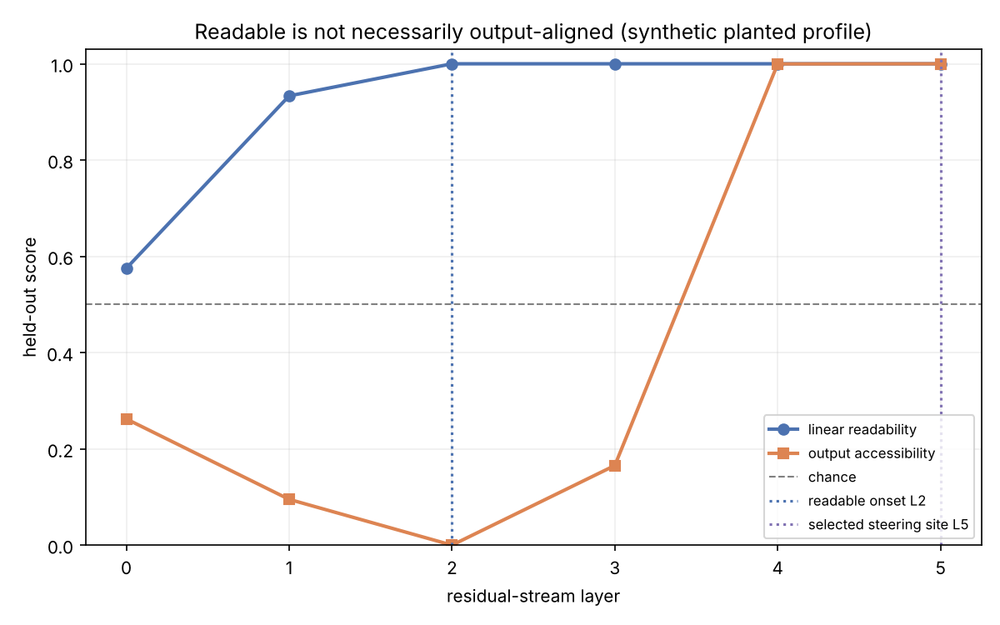

# H004: Does linear readability imply alignment with the model's output basis?

Readable is not necessarily steerable. This sample separates two questions that
are easy to conflate:

1. Can a learned linear probe read the concept at this layer?
2. Is the concept already aligned with the model's own output-token basis?

A probe learns whatever linear basis makes the labels separable. The logit-lens
score is stricter: it applies the model's final normalization and unembedding,
then asks whether positive examples rank above negative examples in that output
basis. A readable direction can therefore be output-anti-aligned. The method
follows Billa (2026), [Predicting Where Steering Vectors
Succeed](https://arxiv.org/abs/2604.15557).

## TL;DR

- At each layer, measure **linear readability** (held-out probe accuracy) and
  **output accessibility** (logit-lens AUC: do positives outrank negatives in the
  model's own output basis?).
- Chance AUC is 0.5, so the logit-lens score has a sign: below 0.5 means the
  concept is readable but pointing the *wrong way* for the output.
- The result is the gap between the two curves: where the concept becomes
  readable versus where it becomes output-aligned.

## Run it

```bash
pip install -e ".[dev]"                                    # from the repo root
python samples/h004_readable_vs_steerable/demo.py          # synthetic, instant, no GPU
```

The default is deterministic, offline, and model-free. It plants a concept that
becomes perfectly readable at layer 2, while its output-basis AUC is below chance
there. Output alignment emerges only in later layers. The script writes a JSON
report and a figure under `figures/`.

For an optional real-model read:

```bash
pip install -e ".[capture]"
python samples/h004_readable_vs_steerable/demo.py --real --model google/gemma-3-1b-it
```

The real path builds token-matched concessive-sentiment pairs, captures all
residual-stream layers in one pass per batch, and checks a critical invariant:
unembedding the final hidden state must reconstruct the emitted logits before it
applies the final norm once to intermediate states. It reports a depth profile
without selecting a steering site, because selecting one requires a separate
causal steering sweep.

## How to read the figure



- **linear readability** (blue): held-out probe accuracy at each layer.
- **output accessibility** (orange): logit-lens AUC at each layer. Above the
  dashed chance line is output-aligned; below it is output-anti-aligned.
- **readable onset** (blue dotted): the first layer where the probe reads the
  concept.
- **selected steering site** (purple dotted, synthetic only): a deep site chosen
  for illustration; it is descriptive, not predicted.

In the synthetic run the blue curve saturates by layer 2 while the orange curve
sits far below chance there, and only crosses above chance from layer 4.

## Takeaway

The synthetic demo proves that perfect linear readability does not imply output
alignment. On the measured research runs, the readable onset was output-
anti-aligned and a separately measured deep steering site was output-aligned on
three small transformers.

## Limits

- That onset/site comparison is descriptive, not a validated layer selector,
  because the deep sites were selected using steering measurements. A held-out
  prediction requires choosing a layer from accessibility alone, then measuring
  steering there on a new concept or model.
- Output accessibility is a logit-lens readout, not a steering measurement. The
  `--real` path reports the depth profile and deliberately does not pick a
  steering site.

## Files

```
h004_readable_vs_steerable/
  demo.py          readability vs output-accessibility profile (synthetic by default, --real for a model)
  figures/         the figure + report JSON the demo writes
  README.md        this file
```

The reusable machinery (`OutputAccessibilityAnalyzer`, `AccessibilityReport`,
`rank_auc`, `AccessibilityPlotter`) lives in the shared package
`src/mechinterp_samples/`. See the top-level README for the design.
